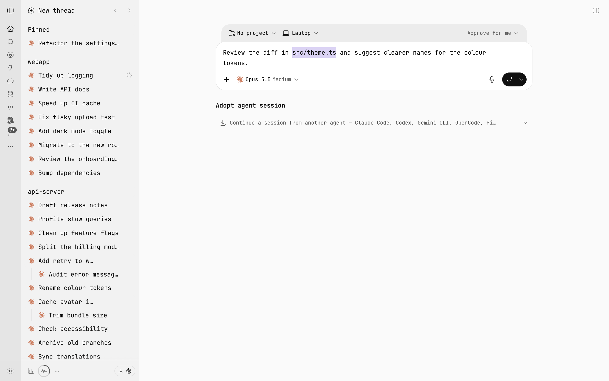
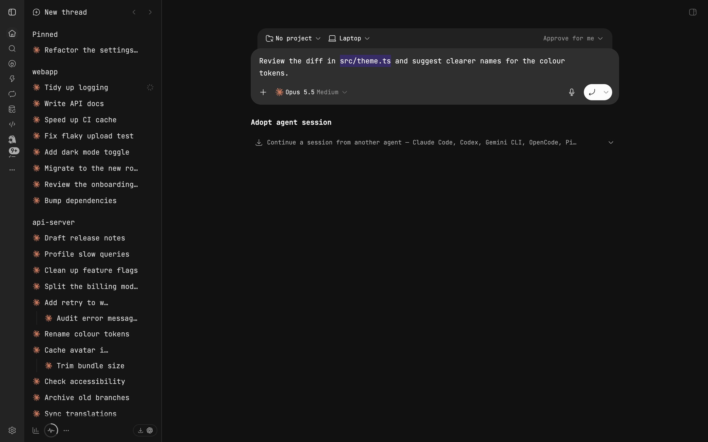
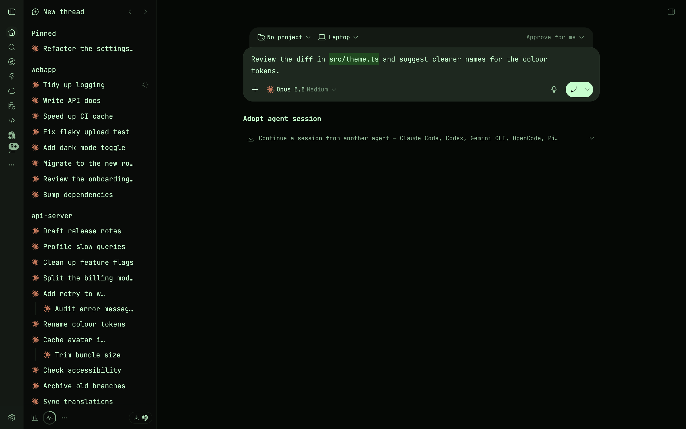
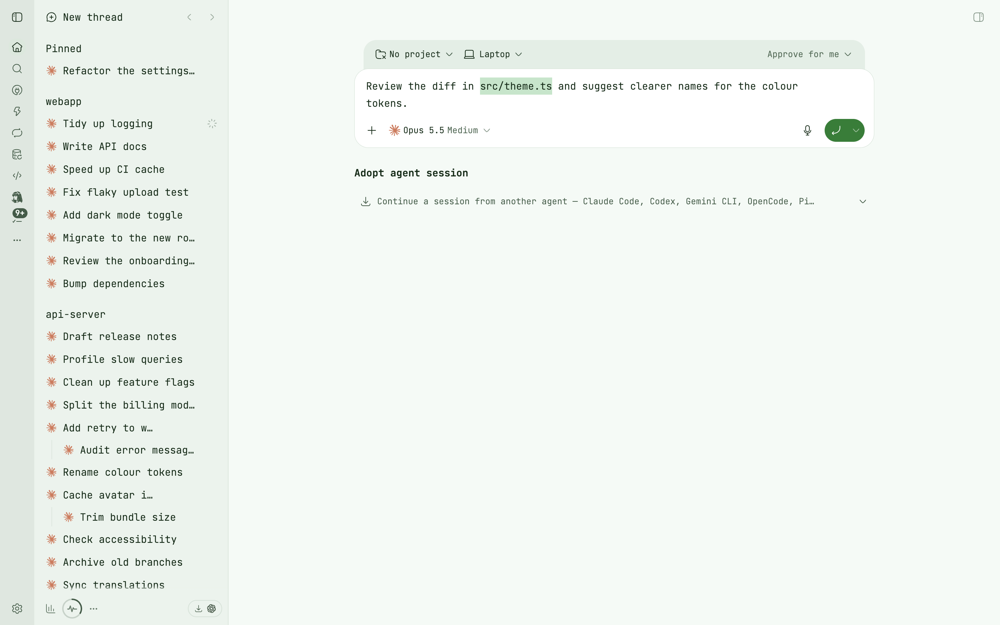

# Graphite Mono for BB

A [BB](https://getbb.app) theme plugin that sets the whole interface in [JetBrains Mono](https://www.jetbrains.com/lp/mono/) at Light weight, with a compact reading scale and a rounded composer. It ships two palettes: **Graphite Mono** (neutral graphite with a violet accent) and **Graphite Mono Matrix** (near-black green with mint text and a phosphor-green accent). Both follow Light, Dark and System appearance.






## What it includes

- JetBrains Mono embedded in the theme (variable 100–800, upright and italic; Latin, Latin Extended and Cyrillic), so nothing loads from the network. Other scripts fall back to the system monospace.
- One weight for reading: all text, inline code and code blocks at Light (300); bold and chat headings at 600.
- A compact text scale: 14/24 for chat and content, 13 for code, 12 for the composer context strip and the model picker. Touch phones get 15/24 and a 16px composer, so iOS does not zoom on focus.
- A composer with a context strip (project, machine, branch, permissions) tucked behind a rounded prompt slab and a round send button.
- Palette colours for text selection, menus, switches and the timeline accent.

## Install

From the BB plugin store, search for Graphite Mono. Or from a terminal:

```sh
bb plugin install git:https://github.com/ponomr/bb-plugin-graphite-mono.git@^0.1.0
```

Then open Settings → Appearance and choose Graphite Mono or Graphite Mono Matrix under Palette.

Requires BB 0.47.1 or later, below 1.0.

## Development

```sh
npm install
npm run themes        # rebuild themes/*.css from src/ and fonts/
npm run check:themes  # fail if a committed theme is stale
npm run typecheck
npm run build
bb plugin install "$PWD"
```

Edit `src/common.css` (typography, sidebar, composer) and `src/palette-*.css` (colours); `themes/*.css` are generated by `scripts/build-themes.mjs`.

## Credits and licence

Theme CSS, build script and packaging © 2026 Alex Ponomar, MIT. JetBrains Mono © 2020 The JetBrains Mono Project Authors, SIL Open Font License 1.1. See [LICENSE](LICENSE), [fonts/OFL.txt](fonts/OFL.txt) and [THIRD_PARTY_NOTICES.md](THIRD_PARTY_NOTICES.md).
